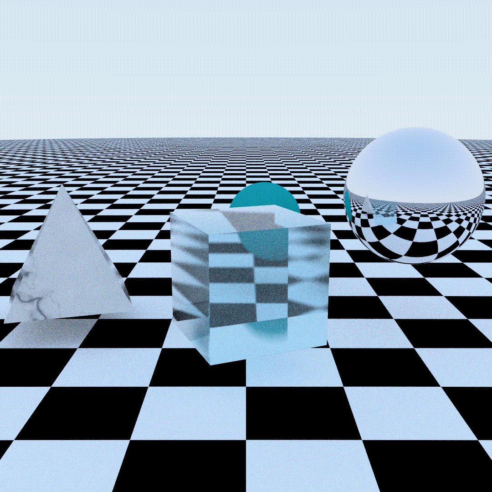

# raywizard

A multithreaded CPU path tracer



## Features

- Materials: glass, chrome, ice, marble, checkerboard, matte
- Sphere, cubes, pyramids, all your wildest dreams come true...
- Pretty slow
- Gawk at the cool reflections, refractions, bow down in awe at the almighty power of the dot product in action
- Output to GIF, MP4, PNG (or PPM)

## Build

Requires CMake and a C++17 compiler. MP4 output also needs [ffmpeg](https://ffmpeg.org) on your `PATH`.

```sh
cd build
cmake .. -DCMAKE_BUILD_TYPE=Release
cmake --build . --parallel
```

## Usage

```sh
./bin/raywizard render.gif      # animated gif
./bin/raywizard render.mp4      # H.264 video
./bin/raywizard render.png      # still image
```
